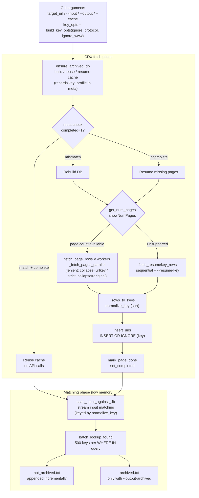

# Wayback Gap Detector — Architecture

## Overview

A CLI tool that compares a local URL list against Wayback Machine CDX API responses to find URLs that have not been archived.
Matching uses [surt](https://github.com/internetarchive/surt) keys, applied with identical settings to both the CDX `original` rows and the local URLs, and compares keys directly.
Only the `original` column is fetched from CDX (`fl=original`).
The cache is a single SQLite `.db` file. Fetching primarily uses pagination in parallel, falling back to sequential resumeKey fetches only when pagination is unavailable.

There are two key modes:

- **lenient (default)**: surt defaults (including `www`/`wwwN` removal, scheme dropping, and query sorting/lowercasing). CDX queries use `collapse=urlkey`.
- **strict** (`--no-ignore-www` / `--no-ignore-protocol`): applies `host_massage=False` / `with_scheme=True`. CDX queries use `collapse=original` (folds only consecutive duplicates of the same `original` spelling; distinct variants are kept).

Page-count queries (`showNumPages`) send the same `pageSize` and `collapse` as page fetches.

## Data flow

## Table design (SQLite)

| Table | Definition | Purpose |
|---|---|---|
| `meta` | `(k TEXT PRIMARY KEY, v TEXT) WITHOUT ROWID` | Run parameters, `key_profile`, `completed` flag, `mode`, etc. Rebuilt automatically when parameters differ |
| `archived` | `(key TEXT PRIMARY KEY) WITHOUT ROWID` | Set of surt keys only (`original` is not stored) |
| `pages_done` | `(page INTEGER PRIMARY KEY)` | Fetched page numbers. On interruption, only missing pages are fetched again |

## Function reference

### Key generation (surt)

| Signature | Description |
|---|---|
| `build_key_opts(ignore_protocol: bool, ignore_www: bool) -> Dict[str, Any]` | surt options for a run. Both defaults (True/True) yield an empty dict == surt defaults == CDX `urlkey` family. `--no-ignore-www` → `host_massage=False`; `--no-ignore-protocol` → `with_scheme=True` (activates strict mode) |
| `key_profile(opts: Dict[str, Any]) -> str` | Stable fingerprint for cache identity (e.g. `surt-default` / `surt:host_massage=False`) |
| `normalize_key(url: str, key_opts=None) -> str` | Converts a URL to a surt key. Empty/blank-only input maps to the sentinel `"-"`. In strict mode with the scheme preserved, only the input scheme is lowercased locally (surt reproduces the input scheme's case as-is) |
| `canonicalize_nodns(url, **_ignored)` | Copy of surt.GoogleURLCanonicalizer.canonicalize. Only `attemptIPFormats()` is replaced with a DNS-free variant (removing `socket.gethostbyname_ex` for numerically shaped hosts). Byte-identical to the default canonicalizer for ordinary hosts |
| `attemptIPFormats_nodns(host)` | All-digit hosts are converted locally (`inet_ntoa`); valid IPv4 quads pass through; octal/invalid numeric-dotted hosts pass through (same behavior as surt when DNS fails, with no network access) |
| `KEY_CANONICALIZER` | `CompositeCanonicalizer([canonicalize_nodns, ia_canonicalize])`. Flags apply only to the IA stage (same shape as the default canonicalizer) |

### SQLite cache layer

| Signature | Description |
|---|---|
| `open_db(path: str) -> sqlite3.Connection` | Opens (creating if needed) the DB. Applies single-file PRAGMAs and initializes the three tables |
| `archived_columns(conn) -> Set[str]` | Column names of the `archived` table (used to detect incompatible layouts) |
| `expected_meta(target_url, key_opts, page_size) -> Dict[str, str]` | Parameter dict defining cache identity (includes `key_profile` and `schema_v`) |
| `read_meta(conn) -> Dict[str, str]` | Reads all `meta` rows into a dict |
| `write_meta(conn, values: Dict[str, str]) -> None` | Overwrites multiple keys in `meta` with `INSERT OR REPLACE` |
| `is_completed(conn) -> bool` | Returns whether the cache is complete (`completed=1`) |
| `set_completed(conn, done=True) -> None` | Sets the completion flag |
| `get_done_pages(conn) -> Set[int]` | Returns the set of fetched page numbers |
| `mark_page_done(conn, page: int) -> None` | Records a page as fetched |
| `insert_urls(conn, keys: Iterable[str]) -> int` | Bulk-inserts surt keys, ignoring primary-key duplicates |
| `count_archived(conn) -> int` | Returns the number of stored keys |
| `batch_lookup_found(conn, keys: List[str]) -> Set[str]` | Returns the subset of keys present via split `WHERE IN` queries |

### CDX API layer

| Signature | Description |
|---|---|
| `make_session() -> requests.Session` | Creates a retrying `Session` (exponential backoff on 429/5xx) |
| `_cdx_params(target_url, *, page=None, page_size=None, resume_key=None, limit=None, collapse=None) -> Dict[str, Any]` | Builds request parameters shared by both fetch paths. `collapse` is `urlkey` for lenient and `original` for strict. `limit` is used only by the sequential resumeKey path |
| `_split_resume_key(data: List) -> Tuple[List, Optional[str]]` | Splits a trailing resumeKey off the response (without mistaking `fl=original` single-column data rows for it) |
| `_strip_header(data: List) -> List` | Removes the header row (`urlkey`/`original`) at the start of a chunk |
| `_get_with_retries(session, api_url, params, headers, timeout=60) -> Response` | GET with up to 3 retries, also detecting empty/non-JSON responses |
| `get_num_pages(target_url, page_size, collapse, session, headers) -> Optional[int]` | Fetches the total page count via `showNumPages`. Sends the same `pageSize`/`collapse` as page fetches (the count must use the same query shape; returns `None` when unsupported) |
| `fetch_page_rows(target_url, page, page_size, collapse, session, headers) -> List[List]` | Fetches one page (follows in-page resumeKey chaining when the server returns one; `limit` is not sent) |
| `fetch_resumekey_rows(target_url, initial_resume_key, limit, collapse, session, headers) -> Generator` | Generator for sequential resumeKey fetching (`limit` is the chunk size; returns the last key via `return` on interruption) |
| `_rows_to_keys(rows, key_opts) -> List[str]` | Converts CDX rows (`fl=original`) into a list of surt keys (`original` spellings are not stored) |
| `_fetch_pages_parallel(target_url, pages, page_size, key_opts, workers, headers, collapse) -> Generator[Tuple[int, List[str]]]` | Fetches the given pages in a thread pool and yields `(page, keys)` as they complete |

### Orchestration and matching

| Signature | Description |
|---|---|
| `ensure_archived_db(target_url, cache_file, key_opts=None, initial_resume_key=None, limit=None, page_size=None, workers=4, refresh=False) -> str` | Determines reuse/resume/rebuild (including profile or column-layout mismatches) and builds the DB, returning its path. Sends `collapse=urlkey` for lenient / `collapse=original` for strict (with tqdm progress) |
| `count_input_lines(input_file: str) -> Optional[int]` | Counts total lines quickly for the `scan_input_against_db` progress bar (returns `None` on failure) |
| `scan_input_against_db(input_file, db_path, key_opts=None, output_file=None, output_archived=None, batch_size=LOOKUP_BATCH_SIZE) -> Tuple[int, int, int]` | Streams, keys, batch-queries, and incrementally writes the input, returning `(total, not archived, archived)` (production path) |
| `main() -> int` | CLI entry point (argument parsing, `build_key_opts`, DB setup, matching, exit code) |

### Test and small-scale helpers

| Signature | Description |
|---|---|
| `extract_archived_urls(cdx_data, key_opts=None) -> Set[str]` | In-memory extraction for small-scale/test use (locates the `original` column from the header and returns a set of surt keys; malformed headers yield an empty set) |
| `detect_not_archived(input_file, archived_keys: Set[str], key_opts=None, collect_archived=False) -> Tuple[List, Optional[List], int]` | In-memory matching for small-scale/test use (keys each line with `normalize_key`). The production path uses `scan_input_against_db` |
