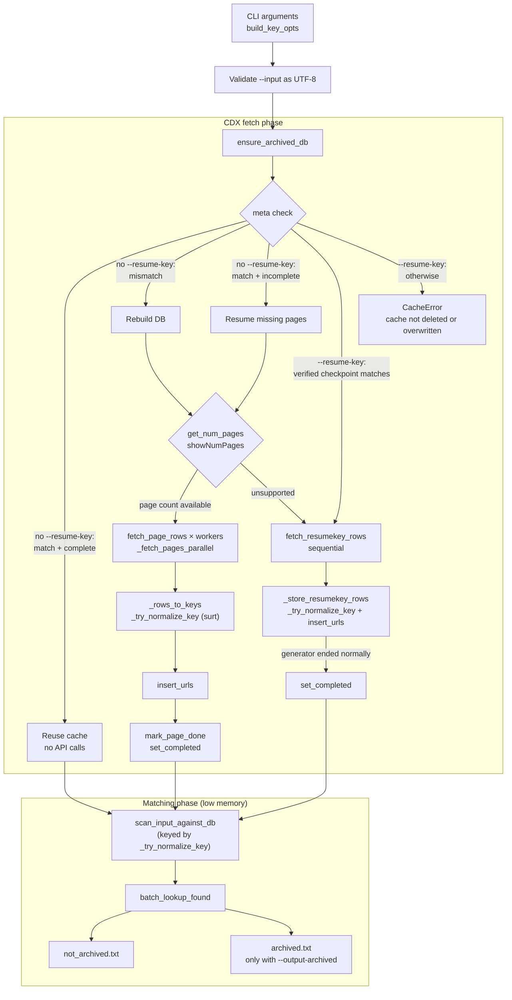

# Wayback Gap Detector — Architecture

## Overview

A CLI tool that compares a local URL list against Wayback Machine CDX API responses to find URLs that have not been archived.
Matching uses [surt](https://github.com/internetarchive/surt) keys, applied with identical settings to both the CDX `original` rows and the local URLs, and compares keys directly.
Only the `original` column is fetched from CDX (`fl=original`).
The cache is a single SQLite `.db` file. Fetching primarily uses pagination in parallel, falling back to sequential resumeKey fetches only when pagination is unavailable.

There are two key modes:

- **lenient (default)**: surt defaults (including `www`/`wwwN` removal, scheme dropping, and query sorting/lowercasing). CDX queries use `collapse=urlkey`.
- **strict** (`--no-ignore-www` / `--no-ignore-protocol`): applies `host_massage=False` / `with_scheme=True`. CDX queries use `collapse=original` (folds only consecutive duplicates of the same `original` spelling; distinct variants are kept).

Page-count queries (`showNumPages`) send the same `pageSize` and `collapse` as page fetches.

## Packaging

The distribution installs the single `waygap.py` module and exposes `waygap:main`
as the `waygap` console command. Setuptools reads the version from the literal
`waygap.__version__`, so the CLI, User-Agent and distribution metadata share one
version. The source archive also includes the tests, documentation and dependency
files; building it does not require importing the runtime dependencies.

## Data flow

## Table design (SQLite)

| Table | Definition | Purpose |
|---|---|---|
| `meta` | `(k TEXT PRIMARY KEY, v TEXT) WITHOUT ROWID` | Run parameters, `key_profile`, `completed` flag, `built_at` (UTC completion time), `mode`, `resume_key`, etc. Rebuilt automatically when parameters differ. `completed` is set to 1 only after the whole fetch finishes, so an interrupted fetch is never reused as complete. `built_at` is written atomically with completion, cleared when marked incomplete, and is not part of cache identity. |
| `archived` | `(key TEXT PRIMARY KEY) WITHOUT ROWID` | Set of surt keys only (`original` is not stored) |
| `pages_done` | `(page INTEGER PRIMARY KEY)` | Fetched page numbers. On interruption, only missing pages are fetched again |

## Function reference

### Key generation (surt)

| Function | Description |
|---|---|
| `build_key_opts` | surt options for a run |
| `key_profile` | Stable fingerprint for cache identity (e.g. `surt-default` / `surt:host_massage=False`) |
| `normalize_key` | Converts a URL to a surt key |
| `_try_normalize_key` | Wraps `normalize_key` for every caller; returns `None` for a URL that surt cannot parse, so the CDX row is skipped and the input line is reported as unarchived |
| `canonicalize_nodns` | Copy of surt.GoogleURLCanonicalizer.canonicalize. Only `attemptIPFormats()` is replaced with a DNS-free variant (removing `socket.gethostbyname_ex` for numerically shaped hosts). Byte-identical to the default canonicalizer for ordinary hosts |

### CDX API layer

| Function | Description |
|---|---|
| `_pause` | Waits for `seconds`, raising the internal `_FetchCancelled` once `stop` is set |
| `_RateLimiter.wait` | Spaces calls at least `interval` seconds apart across threads. The module-level `_CDX_LIMITER` is shared by every CDX request |
| `_RateLimiter.pause` | Holds every caller's `wait()` for the given number of seconds |
| `make_session` | Creates a `Session` that retries only connection and read errors (HTTP 429 is left to `_cdx_get`, 5xx to `_get_with_retries` and `get_num_pages`) |
| `_cdx_get` | Sends one GET through the shared limiter; on HTTP 429, pauses every CDX request before sending again |
| `_wait_after_5xx` | Waits before resending after a 5xx; a Retry-After pauses every CDX request. Shared by `_get_with_retries` and `get_num_pages` |
| `_cdx_params` | Builds request parameters shared by both fetch paths |
| `_split_resume_key` | Splits a trailing resumeKey off the raw response |
| `_strip_header` | Removes the header row (`urlkey`/`original`) at the start of a chunk |
| `_get_with_retries` | GET with retries for page and resumeKey fetches (5xx through `_wait_after_5xx`), also detecting empty/non-JSON responses |
| `get_num_pages` | Fetches the total page count via `showNumPages` |
| `fetch_page_rows` | Fetches one page |
| `fetch_resumekey_rows` | Generator for sequential resumeKey fetching |
| `_rows_to_keys` | Converts CDX rows into a list of surt keys |
| `_fetch_pages_parallel` | Fetches the given pages in a thread pool, keeping only a bounded number of pages in flight, and yields `(page, keys)` as they complete (see [Stopping a pagination fetch](#stopping-a-pagination-fetch)) |

### Orchestration and matching

| Function | Description |
|---|---|
| `_cache_error` | Builds a `CacheError` with the failed SQLite database's path and recovery guidance |
| `ensure_archived_db` | Determines reuse/resume/rebuild (including profile or column-layout mismatches) and builds the DB, returning its path |
| `_store_resumekey_rows` | Inserts the keys of `fetch_resumekey_rows` rows in batches and returns the count. After a failed request (`ResumeKeyRequestError`), the failed request's key is stored in `meta.resume_key` |
| `count_input_lines` | Counts total lines quickly for the `scan_input_against_db` progress bar |
| `scan_input_against_db` | Streams, keys, batch-queries, and incrementally writes the input |
| `main` | CLI entry point (argument parsing, `build_key_opts`, DB setup, matching, exit code) |

### Stopping a pagination fetch

When a page fails, the consumer closes the generator, or Ctrl+C arrives,
`_fetch_pages_parallel` cancels the queued pages and sets a shared stop event:
workers waiting on the rate limiter (including a pause after HTTP 429) or
between retries end at once, and a request already in progress finishes and its result is discarded.

`ensure_archived_db` needs no extra handling: when an exception leaves its
`for` loop (for example Ctrl+C during `insert_urls`), CPython closes the
generator, which stops the work the same way.
